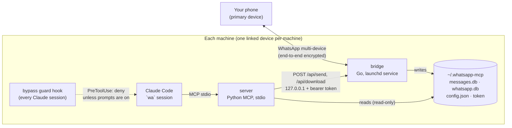

# Architecture overview

Back to [AGENTS.md](../../AGENTS.md). Security reasoning lives in the [security model](./security-model.md);
the decisions behind this shape are in the [ADR index](./decisions/README.md).

## Components



| Component | Module | Runs as | Owns |
|---|---|---|---|
| **bridge** | [`plugins/whatsapp/bridge`](../../plugins/whatsapp/bridge/README.md) | long-running process (`launchd` agent `com.whatsapp-claude.bridge`) | the WhatsApp session (`whatsapp.db`), the message store (`messages.db`), the API token, the allowlist check |
| **server** | [`plugins/whatsapp/server`](../../plugins/whatsapp/server/README.md) | child process of the AI client, per session, over stdio | the MCP tool surface, the `digest` triage view |
| **plugin** | [`plugins/whatsapp`](../../plugins/whatsapp/README.md) | loaded by Claude Code | the guard hook, `/wa-setup`, the triage skill, `wa`, `wa-allow`, `wa-send`, `install.sh`, the Touch ID helper |

## Data flow

1. **Inbound.** WhatsApp delivers every message to every linked device. The bridge records each chat's name (1:1
   chats from your contacts on both the phone and LID address, [ADR 7e2c9d](./decisions/2026-10-30-7e2c9d-chat-discovery-contact-names-and-partial-match.md)) and
   last-activity time for **all** chats, and stores message content **only for allowlisted chats**
   ([allowlist guide](../guides/allowlist.md)).
2. **Reading.** The MCP server opens `messages.db` read-only and answers tool calls. `digest` returns counts and
   short snippets (mentions of you, keyword hits) instead of raw history, so a catch-up across many groups
   stays small.
3. **Sending.** `send_message` / `send_file` (or `wa-send`, which finds the chat by name, number or part of a name
   with `bin/walookup.py`) call the bridge's local API. The bridge refuses any
   recipient not on the allowlist and any file outside the `send_from` folders, and asks for your Touch ID
   before sending to anyone but you or a notification chat (the `WhatsApp for Claude` helper), unless the text
   fits a pattern you armed for that chat with Touch ID beforehand.
4. **Offline.** A sleeping machine's bridge reconnects on wake and WhatsApp delivers what it queued for that
   device. Each machine is a separate linked device with its own store ([runbook](../operations/runbook.md#several-machines)).

## On-disk layout (`~/.whatsapp-mcp`, mode 0700)

| Path | Written by | Contents |
|---|---|---|
| `whatsapp.db` | bridge (whatsmeow) | linked-device keys and session; **deleting it unlinks this machine** |
| `messages.db` | bridge | `chats` (every chat: JID, name, last message time) and `messages` (allowlisted chats only) |
| `config.json` | `wa-allow`, you | `allow_chats`, `allow_direct_chats`, `notify_chats`, `send_from`, `port`; re-read by the bridge on change |
| `token` | bridge, first run | 32-byte hex bearer token for the local API (0600) |
| `media/<chat>/` | bridge | downloaded media, on request only |
| `outbox/` | you | the only folder files can be sent from |
| `app/` | `install.sh` | built bridge binary, `WhatsApp for Claude` Touch ID helper, MCP server, launchers; replaced on reinstall |
| `mcp.json`, `settings.json`, `workspace/` | `install.sh` | the `wa` session's MCP config, permission settings and neutral working directory |
| `bridge.log` | launchd | connection events and errors; **never message text** |

## Repository layout

```text
.claude-plugin/marketplace.json   makes the repo installable as a Claude Code plugin marketplace
plugins/whatsapp/                 the plugin module (module.yaml)
  bridge/                         Go module (module.yaml)
  server/                         Python MCP server (module.yaml)
  hooks/                          bypass guard + its test
  bin/                            install.sh, wa, wa-allow, wa-send, walookup.py (chat lookup)
  approve/                        wa-approve.swift, the Touch ID helper (installed as "WhatsApp for Claude")
  wa/settings.json                permissions for the wa session
  commands/, skills/              /wa-setup, whatsapp-triage
docs/                             architecture, decisions, contributing, guides, operations
agent/principles/                 always-apply rules for agents working in this repo
scripts/check-docs.py             documentation gate (CI job `docs`)
```

## Upstream

The bridge and server are a fork of [lharries/whatsapp-mcp](https://github.com/lharries/whatsapp-mcp) at commit
`7d6a06dc` (2025-07-13), MIT licensed ([`LICENSE.upstream`](../../plugins/whatsapp/LICENSE.upstream)). Why a fork
and what changed: [ADR 2026-10-23-de419c](./decisions/2026-10-23-de419c-fork-and-harden-whatsapp-mcp.md).
